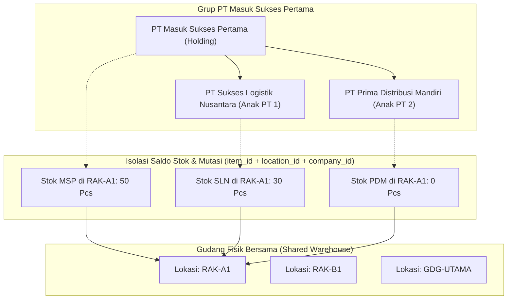

# Product Requirements Document (PRD)
## Masuk Sukses Pertama Warehouse — Multi-Company Shared Warehouse Management System

| Metadata Dokumen | Detail |
| :--- | :--- |
| **Nama Produk** | Masuk Sukses Pertama (MSP) Warehouse Management System |
| **Model Bisnis / Arsitektur** | Multi-Company (Holding & Anak Perusahaan) dengan Gudang Fisik Bersama (*Shared Warehouse*) |
| **Entitas Induk (Holding)** | PT Masuk Sukses Pertama (`MSP`) |
| **Stack Teknologi** | Native PHP 8.x + MySQLi (InnoDB), Bootstrap 5.3, Chart.js 4, TomSelect, ZXing Barcode/QR |
| **Status Implementasi** | **Production-Ready (v2.0 Multi-PT)** |

---

## 1. Visi & Latar Belakang Produk

**PT Masuk Sukses Pertama (MSP)** merupakan perusahaan induk (*Holding*) yang menaungi beberapa anak perusahaan (PT) di dalamnya. Seluruh perusahaan dalam grup menggunakan fasilitas pergudangan fisik yang sama (*Shared Warehouse*), namun secara akuntansi, legalitas dokumen, dan kepemilikan aset, stok barang milik masing-masing PT harus tercatat secara **terpisah dan terisolasi**.

### Masalah yang Diselesaikan
1. **Kepemilikan Stok di Rak Bersama**: Satu rak fisik (misal `RAK-A1`) menyimpan barang milik PT A, PT B, dan PT Induk sekaligus. Sistem harus mencegah PT A mengeluarkan atau meretur stok milik PT B meskipun barangnya sama dan berada di rak yang sama.
2. **Katalog Barang Campuran (*Hybrid Catalog*)**: Ada barang komoditas umum yang dipakai oleh semua PT (*Global Item*), dan ada barang spesifik yang hanya boleh diakses oleh PT tertentu (*Dedicated Item*).
3. **Fleksibilitas Akses SDM**: Manajemen Holding atau staf gudang pusat perlu memantau dan mengoperasikan banyak PT sekaligus melalui **Company Switcher**, sementara staf operasional anak perusahaan hanya boleh melihat dan bertransaksi di PT tempat mereka ditugaskan.
4. **Identitas Legal Dokumen Cetak**: Surat Bukti Barang Masuk, Surat Jalan Barang Keluar, dan Bukti Transfer harus mencetak Kop Surat (Nama Resmi PT, Alamat, Telepon, NPWP) sesuai PT pemilik transaksi.

---

## 2. Konsep Arsitektur Multi-PT (*Shared Warehouse*)

> [!IMPORTANT]
> **Aturan Emas Isolasi Stok**: Kunci unik tabel `stock` adalah `(item_id, location_id, company_id)`. Setiap transaksi yang menambah atau mengurangi stok wajib menyertakan `company_id` dan memvalidasi ketersediaan stok milik PT tersebut di lokasi yang dipilih.

### Tiga Pilar Konsep Multi-PT
| Pilar | Mekanisme Sistem | Implementasi Teknis |
| :--- | :--- | :--- |
| **1. Hybrid Item Catalog** | Barang dapat bersifat **Global** (dipakai bersama oleh semua PT, namun saldo stoknya tetap terpisah per PT) atau **Khusus PT** (hanya muncul di PT pemiliknya). | Kolom `items.company_id` bernilai `NULL` untuk Global, atau berisi `companies.id` untuk Khusus PT. |
| **2. Shared Physical Locations** | Daftar rak/zona gudang (`locations`), kategori (`categories`), satuan (`units`), dan pemasok (`suppliers`) dikelola terpusat agar tidak terjadi duplikasi kode rak di gudang yang sama. | Master lokasi tidak dipecah per PT; pemisahan terjadi pada tabel `stock` dan seluruh tabel transaksi. |
| **3. Multi-Company User Scope** | Setiap user dipetakan ke 1 atau beberapa PT. User dengan akses >1 PT dapat mengganti konteks PT aktif lewat dropdown **Company Switcher** di navbar. | Tabel pivot `user_companies` + session `$_SESSION['active_company']` di `includes/auth.php`. |

---

## 3. Peran Pengguna & Hak Akses (RBAC + Multi-PT)

Sistem menggabungkan **Role-Based Access Control (RBAC)** (apa fitur yang boleh dilakukan) dengan **Company Scope** (di PT mana user boleh melakukannya).

### 3.1. Daftar Role Standar
1. **Super Admin**: Akses penuh ke seluruh fitur (`61 permissions`), termasuk manajemen Perusahaan (PT), Pengguna, Hak Akses Role, dan persetujuan dokumen.
2. **Admin Gudang**: Mengelola master barang/kategori/satuan/supplier/lokasi, membuat & menyetujui transaksi gudang, PO, Stock Opname, serta melihat seluruh laporan pada PT yang ditugaskan.
3. **Staff Gudang**: Operasional harian (membuat Barang Masuk, Barang Keluar, Transfer, Retur Supplier, menghitung fisik Stock Opname) pada PT yang ditugaskan tanpa akses hapus/approve sensitif.
4. **Viewer / Auditor / Manajemen**: Akses *read-only* ke Dashboard, Daftar Stok, Peringatan Stok, dan Laporan/Export CSV pada PT yang ditugaskan.

---

## 4. Spesifikasi Modul Fungsional

1. **Autentikasi, Portal & Konteks Perusahaan**: Login dengan rate limiting, reset password via email, Company Switcher di navbar, serta Portal & Dashboard KPI khusus PT aktif.
2. **Master Data**: Perusahaan (PT), Katalog Barang Hybrid (`Global` vs `Khusus PT`), Import CSV/XLSX, Cetak Barcode Code 39, Kategori, Satuan, Supplier, dan Lokasi Rak Bersama.
3. **Pengadaan (PO) & Barang Masuk**: Pembuatan PO per PT, persetujuan (*Segregation of Duties*), penerimaan bertahap (*Partial Receive*) & penuh (*Full Receive*) dengan *row locking*, serta Barang Masuk langsung dengan kop surat cetak dinamis sesuai PT.
4. **Barang Keluar, Transfer Rak & Retur Supplier**: Validasi stok tersedia per PT di lokasi asal, perpindahan stok antar-rak maupun transfer kepemilikan antar-PT, serta retur barang rusak ke supplier dengan fitur pembatalan atomik.
5. **Pengendalian Persediaan (Stock Opname & Penyesuaian)**: Sesi Stock Opname terstruktur per PT (snapshot stok sistem, input fisik via scan barcode, laporan *variance*, finalisasi otomatis) dan Penyesuaian Stok manual dengan *Four-Eyes Approval*.
6. **Pemantauan Stok, Peringatan & Pelaporan**: Matriks stok per lokasi, peringatan stok minimum & saran jumlah pesan, serta 5 laporan lengkap (Stok, Barang Masuk, Barang Keluar, Mutasi, Performa Supplier) dengan Export CSV & Print yang mendukung mode **Semua PT (Konsolidasi)** maupun spesifik per PT.
7. **Penomoran Dokumen per PT**: Seluruh dokumen transaksi otomatis menyertakan kode PT pada nomor referensinya (`SI-MSP-...`, `SO-SLN-...`, `PO-PDM-...`, `TR-MSP-...`, `RS-SLN-...`, `ADJ-MSP-...`, `OPN-MSP-...`).

